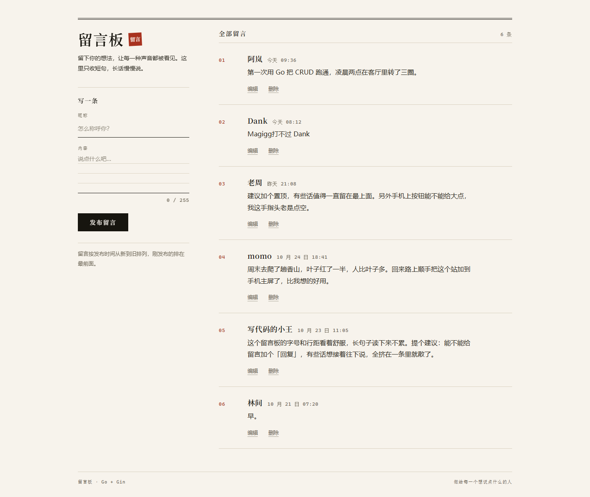
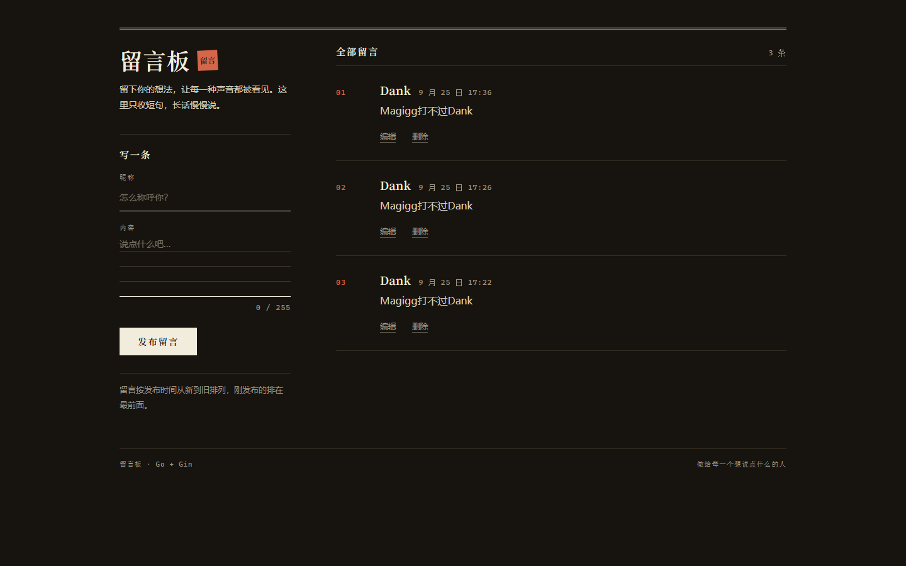
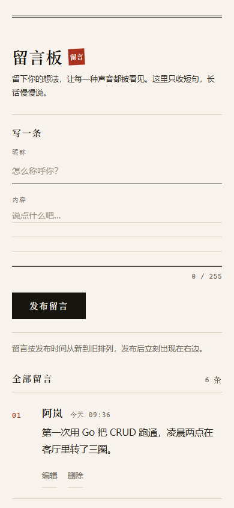

# MessageBoard · 留言板

一个用 Go + Gin + GORM + MySQL 写的留言板：访客填昵称和内容，留言按时间倒序展示，可以编辑和删除。

前后端在同一个仓库里，没有前端构建步骤，`go run .` 就能跑起来。

界面重做过一版，做成了报纸刊头的编辑排版——纸、墨、朱红三色，浅色深色各一套，手机端折成单列。



## 功能

- 发布留言：昵称最多 24 字，内容最多 255 字，输入时实时显示已写多少
- 列表按发布时间倒序，序号自动编号（删掉中间一条会自动重排）
- 时间显示成「刚刚 / 12 分钟前 / 今天 09:36 / 昨天 21:08 / 10 月 24 日 18:41」，完整时刻在悬停时给出
- 编辑、删除；删除先弹确认，再淡出移除
- 发布成功后在表单下方给一句确认，几秒后自己消失
- 浅色 / 深色跟随系统主题；桌面两栏，平板和手机单列

## 技术栈

| 层 | 用了什么 |
|---|---|
| 后端 | Go 1.27、Gin v1.12、GORM v1.31、go-sql-driver/mysql |
| 数据库 | MySQL 8，`utf8mb4`，靠 `AutoMigrate` 自动建表 |
| 前端 | Go 原生模板（`html/template`）+ 手写 CSS + 约 120 行原生 JS，没有构建工具、没有前端框架、没有 npm |
| 字体 | 系统字体栈（衬线 / 无衬线 / 等宽三族），不下载字体文件 |

## 目录结构

```
.
├── main.go                 # 启动、连库、注册路由
├── handlers/message.go     # 增删改查 5 个处理函数
├── models/message.go       # 数据模型（gorm.Model + Name + Content）
├── templates/
│   ├── index.html          # 首页：投稿框 + 留言列表
│   └── edit.html           # 编辑页
├── static/
│   ├── style.css           # 全部样式：设计变量、深色、响应式
│   └── app.js              # 字数计量、相对时间、删除确认、发布提示
└── go.mod / go.sum
```

## 路由

| 方法 | 路径 | 作用 |
|---|---|---|
| GET | `/` | 首页，列出全部留言 |
| POST | `/messages` | 新建留言 |
| GET | `/messages/:id/edit` | 编辑页 |
| POST | `/messages/:id` | 保存修改 |
| POST | `/messages/:id/delete` | 删除 |

## 本地运行

前提：装好 Go 1.27 以上，并且 MySQL 8 已经在跑。

1. 建库：

   ```sql
   CREATE DATABASE messageboard CHARACTER SET utf8mb4;
   ```

2. 改数据库连接，位置在 [main.go:15](main.go#L15)：

   ```go
   dsn := "用户名:密码@tcp(127.0.0.1:3306)/messageboard?charset=utf8mb4&parseTime=True&loc=UTC"
   ```

3. 跑起来：

   ```bash
   go run .
   ```

   第一次启动会把表建好。打开 <http://localhost:8080> 就是首页。

想换端口，改 [main.go:49](main.go#L49) 里的 `r.Run(":8080")`。

## 界面

深色模式（跟随系统主题，这里手动截的）：



手机端：



设计上的取舍写在仓库外的设计稿里，这里只记一条原则：**层级用字号、字体和细线建立，不靠卡片、阴影和圆角**；颜色只有纸、墨、朱红三种，朱红只用来标记位置。

## 已知限制

这是个练习用的演示项目，下面这些是清楚的、没做的：

- **没有登录和权限**：没有"用户"这个概念，任何人都能编辑、删除任何一条留言
- **数据库密码写在代码里**（`main.go` 第 15 行），只适合本地跑。要放到公网，请先改成从环境变量读取
- **没有分页**：留言一多，首页会一次查出全表
- **没有防刷**：公开之后会被脚本灌留言，需要加限流或验证
- `go.mod` 里的依赖都被标成了 `// indirect`，是早期手写依赖留下的；跑一次 `go mod tidy` 就会恢复成正常标记

## License

没有指定 License。自己的练习项目，随便看、随便抄；真要用在别的地方，问一声就行。
